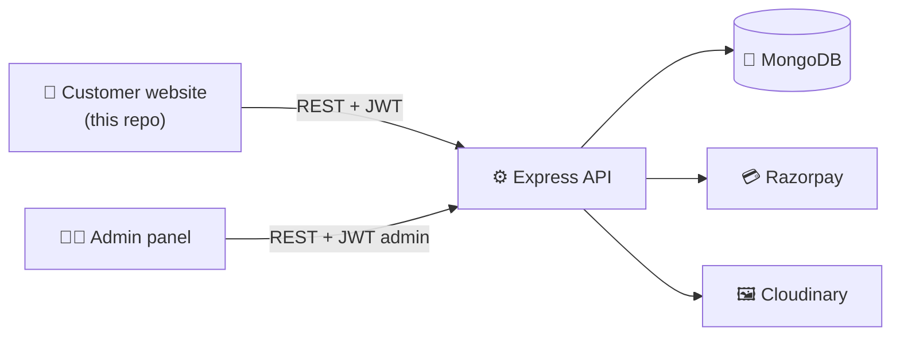
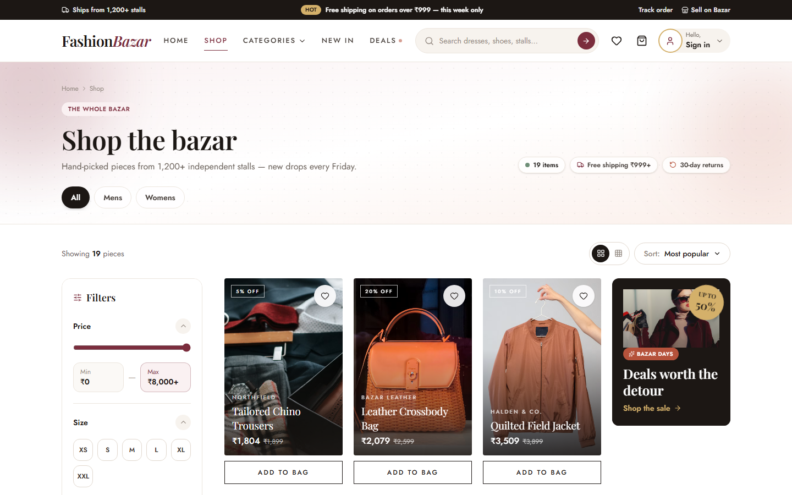
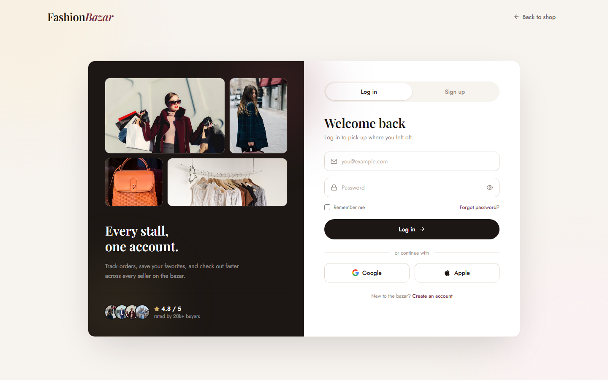

<div align="center">

# 🛍️ Fashion Bazar

**A full-stack fashion store: every stall, one beautiful address**
Browse · filter · bag by size · checkout with Razorpay or cash on delivery · track, cancel and return orders · invoices


</div>

---

## 📦 The Fashion Bazar project

This is the **customer website**. The project has three repositories:

| Repository | What it is | Stack |
|---|---|---|
| **fashion_bazar** *(this repo)* | Customer website | React 19 · Vite · Redux Toolkit · Tailwind |
| **[fashion_bazzar_admin_panel](https://github.com/prajapathiAjay/fashion_bazzar_admin_panel)** | Admin panel | Next.js 16 · Redux Toolkit · Tailwind |
| **[fashion_bazar_backend](https://github.com/prajapathiAjay/fashion_bazar_backend)** | REST API | Node.js · Express · MongoDB |



---

## 📸 Screenshots

<table>
  <tr>
    <td width="50%"><br><sub><b>Shop</b>: search, category chips, filters and sorting</sub></td>
    <td width="50%"><br><sub><b>Log in / sign up</b></sub></td>
  </tr>
</table>

---

## ✨ Features

**Shopping**
- Search (by name, brand, description or category), category pages, new arrivals and deals
- Filters for size and price, five sort orders and pagination, **all kept in the URL**, so a filtered page can be shared or refreshed
- Product page with image gallery, size picker, live stock, sale price with savings, reviews and related products
- **Bag with one line per size**, quantities limited by stock, free-delivery progress bar
- Wishlist

**Checkout**
- Saved addresses with a default, Indian state list and 6-digit pincode
- Delivery options and prices set by the admin; free delivery above a threshold
- Coupon codes checked against the current bag
- **Cash on delivery** or **online payment with Razorpay** (UPI, cards, netbanking, wallets)
- The server recalculates every price, so what's charged always matches the shop

**After the order**
- Order tracker: Ordered → Packed → Shipped → Delivered
- **Cancel** before shipping, with an automatic refund for online payments
- **Return** within 30 days, with refund to the original payment or to UPI/bank for cash on delivery
- **Printable invoice** and **Buy again**

**Account**
- Sign up, log in, **forgot / reset password by email**, change password
- Profile, addresses and wishlist in one account page
- Session expiry handled automatically (logs out and returns you to the same page after logging in again)

**Also**
- Contact form, newsletter, FAQ help centre and store details from the admin panel
- Responsive, mobile-first design with an app-style bottom tab bar
- Form validation with a message under each field, using the same rules as the backend

---

## 🧱 Tech stack

| Area | Tools |
|---|---|
| UI | React 19, Vite, Tailwind CSS 4, lucide-react icons |
| Routing | React Router 7 |
| State & data | Redux Toolkit, **RTK Query** (caching, tag invalidation) |
| Forms | react-hook-form + shared validation rules |
| Payments | Razorpay Checkout |

---

## 🚀 Getting started

### Requirements
- Node.js 20 or newer
- The **[backend](https://github.com/prajapathiAjay/fashion_bazar_backend)** running (default `http://localhost:3200`)

### Install and run
```bash
git clone https://github.com/prajapathiAjay/fashion_bazar.git
cd fashion_bazar/fashion_bazar
npm install
# create the .env file (see below), then:
npm run dev
```
Open **http://localhost:5173**. Keep port 5173: the backend only accepts the website and admin panel from its allowed addresses.

### Environment variables
Create `fashion_bazar/.env` (it's in `.gitignore`, so it's never committed):

```env
VITE_API_URL=http://localhost:3200/api
```

| Variable | Description |
|---|---|
| `VITE_API_URL` | Backend API address. Every request goes here |

> Vite builds `VITE_` values into the browser code, so only addresses go here, never secrets. The Razorpay public key comes from the backend at checkout.

### Scripts
| Command | What it does |
|---|---|
| `npm run dev` | Development server |
| `npm run build` | Production build into `dist/` |
| `npm run preview` | Preview the production build |
| `npm run lint` | ESLint |

### Test payments
Razorpay runs in **test mode**: pay with card `4111 1111 1111 1111`, any future expiry date and any CVV. No real money is charged.

---

## 📁 Folder structure

```
fashion_bazar/
└── src/
    ├── main.jsx              Redux Provider + Router
    ├── AppRoutes.jsx         Every page and its URL
    ├── layouts/              Public layout (navbar, footer, mobile tab bar), auth layout
    ├── pages/                One file per page: Home, Shop, ProductDetail, Cart, Checkout, Account, Invoice...
    ├── components/           Navbar, ProductCard, Footer, ReviewModal, CategoryStrip...
    ├── hooks/                "Is this in my bag / wishlist?", free-delivery threshold
    ├── lib/
    │   ├── store.js          Redux store
    │   ├── slices/           Login token
    │   └── api/              RTK Query endpoints, one file per backend feature
    └── utils/                Prices, shipping and coupon maths, validation rules, Razorpay loader
```

---

## ☁️ Deployment (Render)

1. Create a **Static Site** from this repo with root directory `fashion_bazar`.
2. Build command `npm install && npm run build`, publish directory `dist`.
3. Add `VITE_API_URL` with the live API address, e.g. `https://<your-api>.onrender.com/api`.
4. Under **Redirects/Rewrites**, add a rewrite from `/*` to `/index.html`, so refreshing a page like `/products/123` works.
5. Add the website's live URL to the backend's `ALLOWED_ORIGINS` and `CLIENT_URL`.

---

## 👤 Author

**Ajay Prajapathi** · [GitHub @prajapathiAjay](https://github.com/prajapathiAjay)
