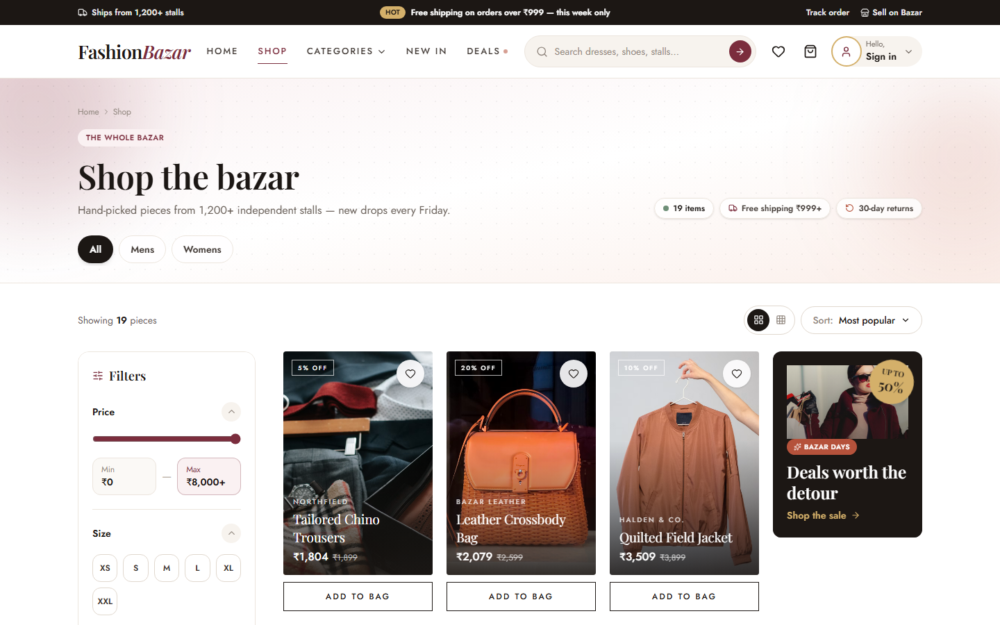
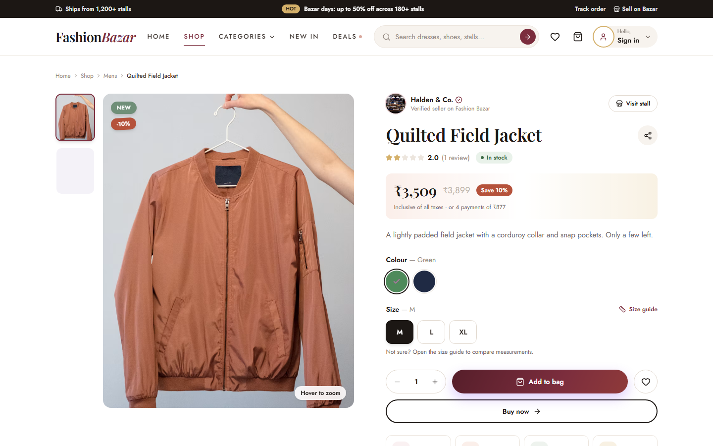
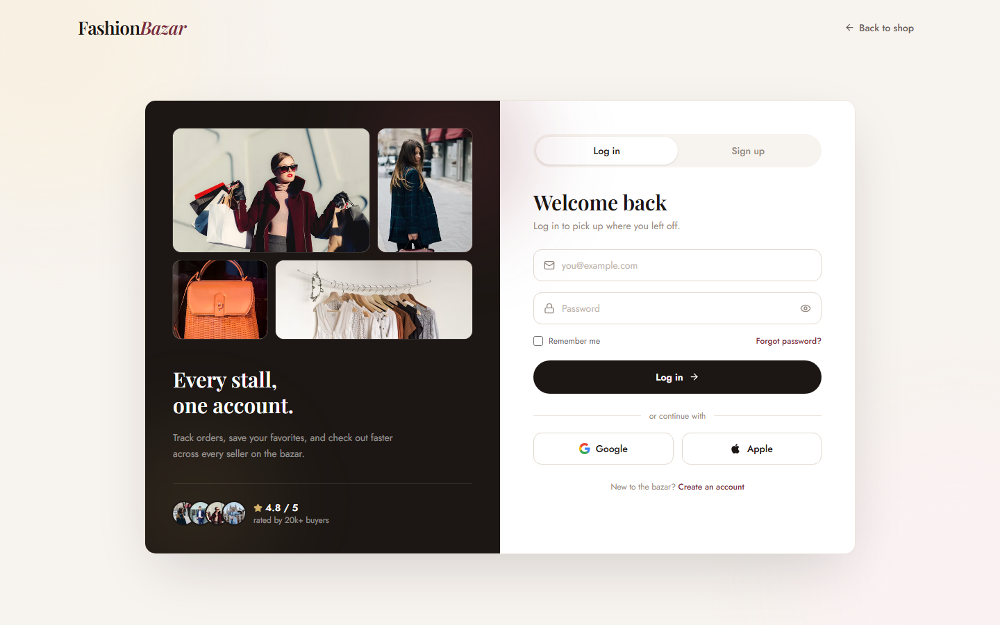

# Fashion Bazar: Shop Website

The customer-facing store for Fashion Bazar. Shoppers browse products, manage a bag and wishlist, check out with Razorpay or cash on delivery, track orders, and manage their account.

Built with **React 19 + Vite**, **Redux Toolkit / RTK Query** for API calls, **React Router 7** and **Tailwind CSS 4**.

> This is one of three projects. It needs the **backend** (`fashion_bazar_backend/backend`) running to work. The **admin panel** (`fashion_bazzar_admin_panel/admin_panel`) manages the products, orders and settings this site shows.

---

## Screenshots

<table>
  <tr>
    <td width="50%"><br><sub><b>Home</b>: hero, featured looks and store stats</sub></td>
    <td width="50%"><br><sub><b>Shop</b>: category tabs, filters, sorting and product grid</sub></td>
  </tr>
  <tr>
    <td width="50%"><br><sub><b>Product</b>: gallery, seller, colour and size, add to bag</sub></td>
    <td width="50%"><br><sub><b>Log in</b>: with sign-up tab and forgot-password link</sub></td>
  </tr>
</table>

---

## Getting started

### 1. Requirements
- Node.js 20 or newer
- The backend running on `http://localhost:3200` (see its folder)

### 2. Install
```bash
npm install
```

### 3. Environment
Create a `.env` file in this folder:

```env
VITE_API_URL=http://localhost:3200/api
```

| Key | What it is |
|---|---|
| `VITE_API_URL` | Base URL of the backend API. Every request is sent to this address. |

### 4. Run
```bash
npm run dev
```
Open **http://localhost:5173**.

> Keep the port as **5173**. The backend only accepts browser requests from `localhost:5173` (this site) and `localhost:3000` (the admin panel). If Vite picks another port because 5173 is busy, requests will be blocked by CORS.

### Scripts
| Command | What it does |
|---|---|
| `npm run dev` | Start the development server |
| `npm run build` | Build for production into `dist/` |
| `npm run preview` | Serve the production build locally |
| `npm run lint` | Run ESLint |

---

## Pages

| Path | Page | Login needed |
|---|---|---|
| `/` | Home: hero, categories, featured products | No |
| `/products` | Shop with search, filters and sorting | No |
| `/categories/:categorySlug` | Shop filtered to one category | No |
| `/new-arrivals`, `/deals` | Shop presets | No |
| `/products/:productId` | Product details, reviews, related products | No (to buy or review: yes) |
| `/cart` | Bag | **Yes** |
| `/checkout` | Address, delivery, coupon, payment | **Yes** |
| `/account` | Orders, profile, password, addresses, wishlist | **Yes** |
| `/orders/:orderId` | One order's details (inside the account page) | **Yes** |
| `/login`, `/register` | Log in / sign up | No |
| `/forgot-password` | Request a reset link by email | No |
| `/reset-password/:token` | Set a new password from the email link | No |
| `/about`, `/sell`, `/contact`, `/help/faq` | Info pages (contact form saves to the backend) | No |
| `/privacy`, `/terms`, `/cookies` | Legal pages | No |

When a logged-out visitor opens a page or button that needs a login, they are sent to `/login` and brought back to the same page afterwards.

---

## Main flows

### Login
- `POST /users/signin` returns a JWT. It is saved in Redux and `localStorage` (`lib/slices/authSlice.js`) and sent as `Authorization: Bearer <token>` on every request.
- Logins last **7 days**. If the backend ever answers **401** to a request that carried a token (expired or invalid), `lib/api/baseApi.js` logs the user out and clears all cached data.

### Checkout
1. The bag lives on the server (`/cartItems`); prices always come from the database.
2. Delivery options and prices come from `GET /shipping` (set in the admin panel).
3. A coupon is checked with `POST /discounts/apply` against the current bag.
4. **Cash on delivery:** `POST /orders` creates the order.
   **Pay online:** `POST /orders` creates a Razorpay order, the Razorpay popup opens, and `POST /orders/verify-payment` checks the signature and creates the real order.
5. The server empties the bag and reduces stock, then the success screen shows.

### Forgot password
1. `/forgot-password` sends `POST /users/forgot-password` with the email.
2. The backend emails a link: `http://localhost:5173/reset-password/<token>` (valid **15 minutes**, works **once**).
3. `/reset-password/:token` sends `POST /users/reset-password` with the token and new password.

The same "check your inbox" message is shown whether or not the email has an account, so the form can't be used to find registered emails.

---

## Folder structure

```
src/
├── main.jsx              Entry: Redux Provider + BrowserRouter
├── App.jsx               Scroll reset + routes
├── AppRoutes.jsx         Every page and its URL
├── layouts/              PublicLayout (navbar, footer, mobile tab bar), AuthLayout
├── pages/                One file per page
├── components/           Shared UI: Navbar, ProductCard, Footer, ReviewModal...
├── hooks/                useCart / useIsWishlist: "is this product in my bag / wishlist?"
├── lib/
│   ├── store.js          Redux store
│   ├── slices/           authSlice: the login token
│   └── api/              RTK Query endpoints, one file per backend feature
│       └── baseApi.js    Base URL, auth header, auto-logout on 401
├── utils/                Price formatting, shipping maths, coupon maths, Razorpay loader
└── assets/               Image URLs
```

### Adding an API call
1. Open (or create) the file for that feature in `src/lib/api/`.
2. Add an endpoint with `baseApi.injectEndpoints`, following the others: `query` for reading, `mutation` for changing data, plus `providesTags` / `invalidatesTags` so lists refresh.
3. Export the generated hook (for example `useGetProductsQuery`) and use it in the page.

---

## Not finished yet

| Feature | State |
|---|---|
| Change password (account page) | Form only, not connected. The backend route must check the current password first. |
| Order buttons: Track, Buy again, Return, Invoice | No action yet |
| Edit address / set default address | Started, commented out |
| Customer cancelling their own order | Not built (only admins can cancel) |
| Google / Apple sign-in | Buttons only |
| Changing the login email | The field is read-only; needs its own verified flow |
| "Start selling" | Links to normal sign-up; no seller flow |
